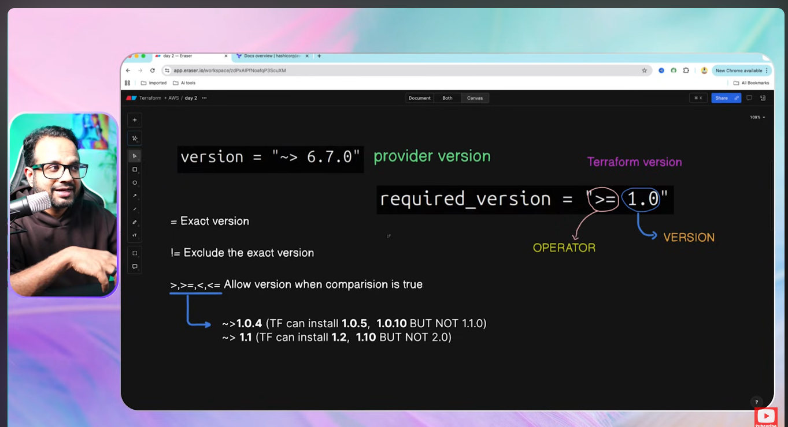

1.  This provider is actually a bridges the gap between the terraform and the code that the cloud provider will understand ..

provider translate the terraform language (HCL) to the language that the cloud provider will understand .. 

3. we initialized the provider using terraform init command ..

LOOK INTO THIS TOPICS 
1. STRUCTURE OF TERRAFORM PROVIDER
